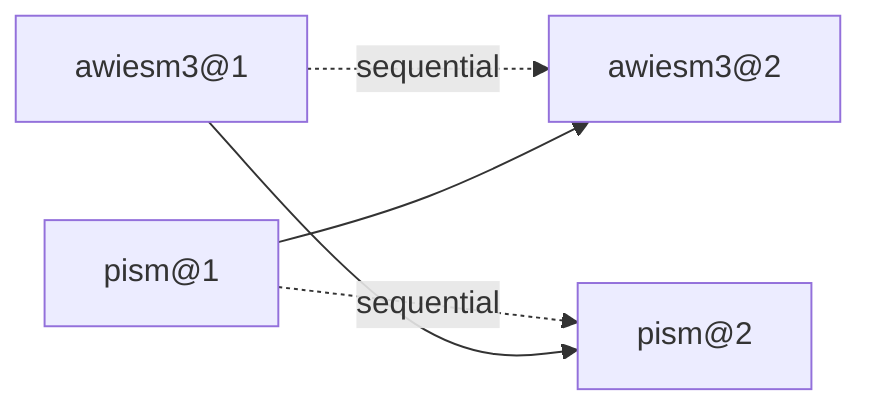
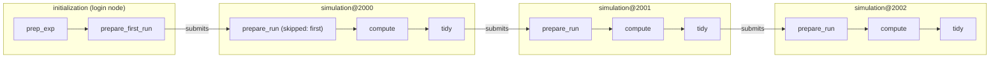
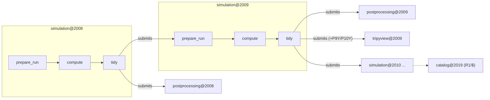
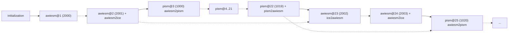
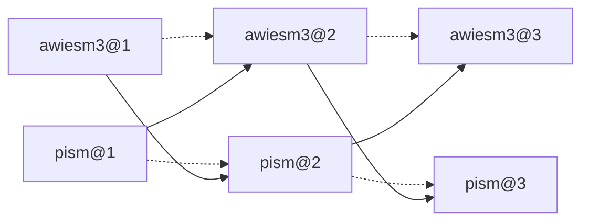

This is not a finished document! A lot of things are not yet set in stone or unclear.
It is meant to be used for starting the development and to help us lock into a final design.
Sections marked **[locked]** reflect decisions the team has already taken; everything else
is a proposal open for discussion. Items marked **[verify]** need to be double-checked.

Related issues:
* Execution plan: https://github.com/esm-tools/esm_tools/issues/1613
* Vocabulary: https://github.com/esm-tools/esm_tools/issues/1519
* Syntax examples: https://github.com/esm-tools/esm_tools/issues/1521 (closed, the discussion
  is archived there and its content is folded into this document)

Table of contents:

1. [Overview and requirements](#1-overview-and-requirements)
2. [Vocabulary](#2-vocabulary)
3. [Workflow elements](#3-workflow-elements)
4. [Survey of existing workflows](#4-survey-of-existing-workflows)
5. [Cycling](#5-cycling)
6. [Job bundles](#6-job-bundles)
7. [Syntax examples](#7-syntax-examples)
8. [Cylc inspiration](#8-cylc-inspiration)
9. [Classes](#9-classes)
10. [Open questions](#10-open-questions)

# 1. Overview and requirements

ESM-Tools' workflow manager is designed for HPC systems where no daemon can run on a
login node or server. Instead, an initial plan sets up the workflow, prepares the first
job script (sbatch/PBS) and submits it to the scheduler. Each job script contains at least
one plan: a **local daemon** (an `esm_runscripts` call running in the background of the job)
that monitors the special inline `compute` multi-step, runs the other multi-steps, and writes the
batch scripts of the plans that follow and submits them.

Requirements:

* **No persistent daemon [locked]**: the scheduler drives the workflow through
  self-submission. The only long-living processes are the ones inside a batch job.
* **Only local DAGs [locked]**: the DAG of the experiment is never built nor stored. Plans
  and multi-steps understand their **local DAG** (their direct predecessors and successors,
  within the same cycle and across cycles) by computing it on the fly from the workflow
  configuration. With that knowledge they can write the `.run` files of their successors
  and submit them.
* **One plan, one `.run` file [locked]**: every plan is written into its own batch script
  that could be submitted by hand with `sbatch`/`qsub`. Grouping several plans in a single
  scheduler job is done with an additional wrapper, the [job bundle](#6-job-bundles).
* **Cycling at plan level [locked]**: plans are what is repeated (cycled). Multi-steps and
  steps are not cycled independently, they run once per plan instance (possibly
  conditioned on the cycle point, see [restrictions](#53-restricting-multi-steps-to-some-cycle-points)).
* **One runscript per experiment [locked]**: also multi-model iterative/offline coupled
  experiments (e.g. AWI-ESM2-PISM) and accelerated coupling are described by a single
  runscript. Different "phases" of the experiment are expressed through cycling, not
  through separate runscripts.
* **Close to a plain runscript**: modelers care about how the simulation runs
  (environment, launch command, etc.), not about ESM-Tools. The compute part of the `.run`
  file reads like a hand-written job script, so the ESM-Tools parts can be commented out
  and the simulation run as-is, which is useful for debugging.
* **Concurrency only at scheduler and step level [locked]**: parallelism happens between
  plans (separate scheduler jobs or a concurrent job bundle) and inside steps (dask,
  parallel bash). Multi-steps of a plan never run concurrently. The observation of the
  simulation (formerly `observe_compute`) becomes part of the compute multi-step.

# 2. Vocabulary

Modified from https://github.com/esm-tools/esm_tools/issues/1519. We follow the
[P-Plan ontology](https://www.opmw.org/model/p-plan/) for the structural elements and add a
few execution-only concepts that have no P-Plan counterpart.

From most coarse to most granular:

| Classic term | Example | Legacy name | New name | YAML key | P-Plan |
| --- | --- | --- | --- | --- | --- |
| total workflow | a full simulation workflow | experiment | experiment plan | `workflow` | `p-plan:Plan` |
| cluster | `simulation`, `postprocessing` | `subjob_clusters`, cluster | plan | `workflow.plans.<name>` | `p-plan:Plan` |
| phase / job | `prepcompute`, `tidy` | `subjobs`, phase | multi-step | `workflow.multi_steps.<name>` | `p-plan:MultiStep` (a step decomposed into steps), linked to its plan via `p-plan:isStepOfPlan` |
| recipe step | `_read_date_file` | recipe step | step | `workflow.multi_steps.<name>.steps` | `p-plan:Step`, linked via `p-plan:isStepOfPlan` |

Execution concepts (no P-Plan counterpart):

| Term | Meaning |
| --- | --- |
| cycle point | The "label" of one repetition of a plan: an integer (`3`) or a date (`2001-01-01`). See [cycling](#5-cycling). |
| plan instance | A plan at a given cycle point, e.g. `simulation@2001-01-01` or `pism@3`. This is what becomes a `.run` file and a scheduler job. Equivalent to Cylc's *task instance*. |
| recurrence | The set of cycle points at which a plan (or a multi-step, or a dependency) exists, e.g. every cycle point, every 10 years, or "cycle points 1 and 2 of every 22". See [recurrences](#52-recurrences). |
| job bundle | A wrapper batch script that runs several plan instances inside a single scheduler job. See [job bundles](#6-job-bundles). |
| local daemon | The `esm_runscripts` process that runs in the background of a job and drives the non-inline multi-steps, the observation of compute, and the submission of successors. |

Notes:

* **Multi-step**: the P-Plan name for a step that is itself decomposed into steps
  (`p-plan:MultiStep`, `p-plan:isDecomposedAsPlan`). The code uses the same name
  (`MultiStep`, `multi_steps` in `src/esm_runscripts/pplan/plan.py`), and so do the YAML
  key (`multi_steps`) and this document.
* `job_bundle` is deliberately not called just `bundle`: `prov:Bundle` / `p-plan:Bundle`
  already exist in the ontology with a different meaning (a named set of provenance
  descriptions).

# 3. Workflow elements

## 3.1. Experiment plan

Group of plans and their dependencies that, once run, leads to a finished experiment. It is
never materialized as a full DAG (see [only local DAGs](#1-overview-and-requirements)); it
is the `workflow` section of the configuration.

**Parent**: None
**Children**: plans

## 3.2. Plans

Group of multi-steps that are executed together on the same host, one after the other, and
the building blocks of the experiment plan. **Cycling happens at this level.**

**Parent**: experiment plan
**Children**: multi-steps

* A plan is written down in its own batch script (sbatch, PBS script, etc. with extension
  `.run`) or executed in the shell of the login node (to cover the experiment
  initialization plan).
* Plans are not nested: a plan cannot submit or contain another plan inside its own job.
  Running several plans in the same scheduler job is the job of a
  [job bundle](#6-job-bundles).
* A plan instance knows its local DAG: which plan instances precede it and which ones
  follow it, in the same cycle and in the following cycles.
* A plan writes the `.run` files of the plan instances that directly depend on it and
  submits them, as soon as all their predecessors are done (see
  [execution mechanics](#58-execution-mechanics-local-dags-and-and-joins)).

Plan keys:

| Key | Values | Meaning |
| --- | --- | --- |
| `execution` | `login_node`, `batch`, `local` | Where the plan instance runs. `login_node`: in the shell in which `esm_runscripts` was called (only for the initialization plan). `batch`: submitted to the scheduler. `local`: a new background process inside the current job/host, without the scheduler. |
| `preceded_by` | list of plan dependencies | Plan-level dependencies, see [dependencies](#54-dependencies). |
| `cycle` | dict | How the plan cycles, see [cycling](#5-cycling). |
| `components` | list of model names | (Optional) Which components of the setup this plan runs/handles. Needed when different plans run different models (e.g. AWI-ESM2 and PISM). Defaults to all components. |
| `calendar` | dict | The model calendar of this plan (`initial_date`, `final_date`, `run_length`), see [model calendars](#55-model-calendars-in-integer-mode). In datetime mode only `run_length` is used, and it is the default recurrence of the plan. |
| `resources` | dict | Batch resources (`nproc`/`nodes`, `partition`, `time`, ...). For the plan containing `compute` they are computed from the components, as today. |

**Equivalent in the old workflow manager**: ~clusters

## 3.3. Multi-steps

Group of steps and their ordering.

**Parent**: plan
**Children**: steps

* Multi-steps of the same plan instance run **sequentially**, never concurrently.
* The **compute** multi-step is special: it is not triggered by the local daemon but is
  written inline in the `.run` file (`launch_mode: inline`) so that the `.run` file reads
  like a plain runscript. The observation of the simulation (checking the logs and killing
  the job if the simulation fails) is not a separate concurrent multi-step anymore but part
  of the compute multi-step machinery (the local daemon is started in the background right
  before the inline launch command, and observes it).
* A multi-step may precede a multi-step of **another** plan (e.g. `catalog` preceded by
  `tidy`). In that case, when the multi-step finishes, it is the one writing and submitting
  the `.run` file of the other plan instance, without waiting for the rest of its own plan
  to finish. This means batch scripts can be written and submitted at the end of any
  multi-step, not only at the end of a plan.
* The **entry points** of a plan are its multi-steps that have no predecessor inside the same
  plan. The **exit points** are the multi-steps that have successors outside the plan
  instance (in another plan or in the next cycle). A plan can have several exit points; in
  the simulation plan `tidy` is the exit point (it precedes `catalog` and hands over to the
  next cycle).

Multi-step keys:

| Key | Values | Meaning |
| --- | --- | --- |
| `plan` | plan name | Plan this multi-step belongs to (`p-plan:isStepOfPlan`, `step_of_plan` in the code). |
| `type` | `esm_multistep`, `bash` | `esm_multistep`: a list of Python steps (old recipe steps, or plugins) executed by the local daemon through `esm_plugin_manager`. `bash`: a bash script. |
| `launch_mode` | `daemon` (default), `inline` | `inline`: the content is written directly into the body of the `.run` file and runs in the foreground of the job (the compute launch command). `daemon`: run by the local `esm_runscripts` daemon. |
| `preceded_by` | list of multi-step names | Multi-step-level dependencies (same cycle). A list means **all of them** (AND). |
| `steps` | list | The steps (see below). |
| `file` | path | (Only `type: bash`, `launch_mode: inline`) Template used to render the inline part, e.g. the compute block of the `.run` file. |
| `cycle` | dict | Restrict in which cycle points of its plan this multi-step runs (`only`/`skip`, see [restrictions](#53-restricting-multi-steps-to-some-cycle-points)). |

**Equivalent in the old workflow manager**: phases/subjobs

## 3.4. Steps

Python functions or bash scripts that make a multi-step.

**Parent**: multi-steps

* Steps are a list in the multi-step (`steps:`), which answers the open question from #1521
  ("where do the recipe steps hook in?"): there is no separate recipe layer, the recipe
  of a multi-step is its `steps` list.
* A step is either the name of a Python function (old recipe step or plugin), or a dict
  describing a script with its environment (as for the subjobs of the current workflow
  manager):

  ```yaml
  steps:
      - _read_date_file          # Python function / plugin
      - assemble_files
      - tripyview:               # script step
            script: ${general.esm_configs_dir}/components/fesom/tripyview.sh
            args: "${fesom.experiment_outdata_dir} ${general.run_datestamp}"
            environment: env_tripyview.py
  ```

* Run sequentially. Parallelization can be achieved inside the step (dask in Python or
  internally in the bash script).

**Equivalent in the old workflow manager**: recipe steps

## 3.5. Dependency semantics in a nutshell

There are two kinds of edges, and they are kept separate (the current
`Workflow.resubmit_triggers` mixes both):

* **Same-cycle edges**: `tidy@2001 -> catalog@2001`. Expressed with `preceded_by` in
  multi-steps or plans.
* **Cross-cycle edges**: `simulation@2000 -> simulation@2001`,
  `pism@2 -> awiesm@3`. Expressed with an `offset` in plan-level `preceded_by` (plus the
  implicit dependency of a plan instance on the previous instance of the same plan).

A list in `preceded_by` means **AND**: the node waits for all its predecessors. This fixes
a gap in the current implementation, where each predecessor triggers the target on its
own. The `prepare_first_run or prepare_run` situation from the first syntax sketch does not
need OR logic: it is resolved by cycling (see [Example 7.2](#72-awi-cm3-with-postprocessing-catalog-and-tripyview)).
An `any_of` key at plan level is kept as an escape hatch for exceptional cases, but it is
not needed by any of the workflows we know about.

# 4. Survey of existing workflows

This section lists the workflows we have in production or development, what machinery they
use today and which concept of the new design replaces it.

| Workflow | Where | What it does today | Replaced by |
| --- | --- | --- | --- |
| Default | `workflow.py` (`init_total_workflow`, `prepend_newrun_job`) | `newrun -> prepcompute -> compute -> tidy -> (resubmit)`, `next_run_triggered_by: tidy` | Implicit plans `initialization` + `simulation` with `cycle: {recurrence: P1Y}` ([7.1](#71-minimal-default-workflow)) |
| AWI-CM3 postprocessing | `configs/setups/awicm3/awicm3.yaml` | Batch subjob on the `pp` partition, `run_after: tidy` | Separate plan `postprocessing`, `preceded_by: [simulation]` |
| FESOM tripyview | `configs/components/fesom/fesom.tripyview.yaml` | Subjob after `tidy` | Plan with `cycle: {recurrence: +P9Y/P10Y}` |
| FOCI monitoring | `configs/setups/foci/foci.yaml` | `echam_postprocessing`, `echam_monitoring` with `order_in_cluster: sequential` | Plans, optionally in a sequential job bundle |
| AWI-ESM3 `Combine_LPJG` | `configs/components/lpj_guess/lpj_guess.yaml` (awiesm3 branch) | Batch subjob on `pp`, `order_in_cluster: concurrent` | Plan `combine_lpjg` ([7.5](#75-awi-esm3-carbon-cycle-awiesm3-co2-branch)) |
| AWI-ESM3 `Rename_XIOS_FESOM(_REG)` | `configs/components/fesom/fesom-2.{7,8}.yaml` (awiesm3 branch) | Shell subjobs after `tidy` | Multi-steps of the simulation plan |
| AWI-ESM3 iceberg budget | `configs/setups/awiesm3/awiesm3.yaml` (awiesm3 branch) | `icb_seed` with `run_before: prepcompute`, `icb_budget` with `run_after: tidy` | Multi-steps of the simulation plan |
| AWI-ESM3 interactive CO2 | `configs/setups/awiesm3/awiesm3.yaml` (awiesm3 branch) | OASIS exchange of CO2 fields between OIFS, FESOM-REcoM and LPJ-GUESS **during** compute | Nothing: it is not a workflow feature, it lives inside `compute` |
| AWI-ESM2-PISM | `runscripts/awicm-pism/` | 3 runscripts (top level with `model1`/`model2` + one per model), `iterative_coupling: True`, `chunk_size` per model, state in `<expid>_chunk_date` + `<expid>_<setup>.date`, `run_only: first/last_run_in_chunk`, `skip_chunk_number: 1`, `files_to_wait_for` polling, "all models over" check | Integer cycling, one plan per model, recurrence sections, plan dependencies with offsets ([7.3](#73-awi-esm2-pism-in-a-single-runscript)) |
| AWI-ESM2-PISM dual hemisphere | `runscripts/awicm-pism/coupling_dual-hemisphere/` | 4 runscripts, 2y AWI-ESM then 20y `pism_nh` and 20y `pism_sh` | Same, with two PISM plans in parallel ([7.3](#73-awi-esm2-pism-in-a-single-runscript)) |
| AWI-ESM3-PISM serial | awiesm3 branch, `*_couple.yaml` | Same mechanism as AWI-ESM2-PISM | Same as AWI-ESM2-PISM |
| AWI-ESM3-PISM concurrent | awiesm3 branch, `concurrent_coupling.py`, `hold_allocation.py` | Two chains one cycle apart. `<model>_chunk_<N>.done` markers, `.parked.<chain>` files, `revive_parked_sibling()`, `--coupling-chain`, waiting inside the allocation with `hold_allocation` | Cross-cycle dependencies with `offset: -1` on both plans + AND-join submission + vertical job bundles ([7.4](#74-awi-esm3-pism-concurrent-coupling)) |

Legacy keys and features, and their equivalent:

| Legacy | New |
| --- | --- |
| `subjob_clusters` / `plans` (cluster) | `plans` |
| `subjobs` | `multi_steps` |
| `subjob_cluster` / `parent_plan` | `plan` (in the multi-step) |
| `run_after` | `preceded_by` |
| `run_before` | `preceded_by` in the target (flipped, as `_flip_legacy_run_before` does already) |
| `first_task_in_queue` / `entry_point` | Derived: multi-steps of a plan without predecessors in the same plan |
| `last_task_in_queue` / `exit_point`, `next_run_triggered_by` / `next_iteration_trigger` | Derived: implicit dependency of the next cycle on the previous one (`cycle.sequential`) + exit points |
| `submit_to_batch_system`, `batch_or_shell` | `execution` (plan) |
| `order_in_cluster` | Multi-steps are always sequential; concurrency between plans via `job_bundles.<name>.order` |
| `run_on_queue` | `resources.partition` |
| `run_only: first_run_in_chunk` / `last_run_in_chunk` | `cycle.only: <recurrence>` on the multi-step |
| `skip_chunk_number`, `skip_run_number` | `cycle.skip` on the multi-step; dependencies before the initial cycle point are ignored |
| `files_to_wait_for` | Real dependencies between plans |
| `iterative_coupling`, `model1`/`model2` runscripts | One runscript, one plan per model with `components` |
| `chunk_size`, `chunk_unit` | Number of cycle points of a plan per period of its recurrence (e.g. `[P22, 2/P22]`) |
| `nyear`, `nmonth`, ... | Still supported: mapped to `calendar.run_length` of the default workflow (see [5.2](#52-recurrences)) |
| `coupling_mode: concurrent`, `--coupling-chain` | Offsets in `preceded_by` |
| `hold_allocation` | Vertical job bundle (`cycles_per_job`) |

Pain points of the current implementation that the design should remove:

* Multi-model experiments need several runscripts and a top-level file that switches
  between them (`config_initialization.init_iterative_coupling`), with a state file
  (`<expid>_chunk_date`) storing which model is next.
* Coupling environment scripts hard-code which model is which (`config["model1"]`,
  `config["model2"]` in `env_echam.py`, `env_pism.py`, `env_pism2awiesm.py`).
* Dependencies between models are expressed by polling for files
  (`files_to_wait_for`, `wait_for_iterative_coupling`), instead of by the workflow.
* The concurrent mode of AWI-ESM3-PISM needs its own park/revive protocol on top of the
  workflow manager.
* `resubmit_triggers` cannot tell "next cycle" edges apart from "same cycle" edges, and has
  no AND-join.

# 5. Cycling

Cycling is the process of running a plan multiple times. In our workflows this is normally
running the next chunk of simulated time, but it is also how we alternate between models
in offline coupling (AWI-ESM2-PISM), how we run models concurrently with a lag
(AWI-ESM3-PISM), and how we run things only every N runs (e.g. tripyview every 10 years).

The design answers the two challenges identified in #1521:

1. **How to define cycling**: with cycle points, a **recurrence** per plan, and plan
   dependencies with offsets.
2. **How to alternate groups of cycles** (e.g. N cycles of AWI-ESM2 and then M cycles of
   PISM, or PISM cycles in parallel to OIFS-FESOM-LPJ-GUESS cycles): with **recurrence
   sections**, the approach of Cylc. All plans share a single cycle axis, each plan exists
   only at the cycle points of its recurrence, and dependencies can be scoped to a
   recurrence. No additional concept (like chunks or sub-cycles) is needed.

The concepts (cycle points, ISO 8601 recurrences, recurrence sections, exclusions, offsets,
runahead limit, integer and datetime cycling) are taken from
[Cylc](https://cylc.github.io/cylc-doc/stable/html/user-guide/writing-workflows/scheduling.html),
see [section 8](#8-cylc-inspiration).

## 5.1. Cycle points and cycling modes

Each plan instance is identified by `(plan, cycle point)`. The cycling mode is set for the
whole experiment (as in Cylc, a workflow cannot mix both modes):

```yaml
general:
    workflow:
        cycling_mode: datetime    # datetime (default) or integer
```

* **`datetime` mode**: cycle points are model dates, from `general.initial_date` to
  `general.final_date`. This is the natural mode for single-model or fully coupled
  experiments with a single calendar (including AWI-ESM3 with interactive CO2).
* **`integer` mode**: cycle points are integers `1, 2, 3, ...` up to
  `general.workflow.final_cycle`. A cycle point is just a slot in the sequence of jobs of
  the experiment, and each plan carries its own model calendar (see
  [model calendars](#55-model-calendars-in-integer-mode)). This allows coupling models that
  live in different time axes (e.g. AWI-ESM2 in years 2000-2010 and PISM in years
  1000-15000) and accelerated coupling (2 years of AWI-ESM per 20 years of PISM).

## 5.2. Recurrences

Every plan with a `cycle` block exists at the cycle points described by its `recurrence`:

```yaml
workflow:
    plans:
        simulation:
            cycle:
                recurrence: P1Y       # every year, from the initial cycle point
                sequential: true      # default: each instance depends on the previous one
```

Most users never write a recurrence: in datetime mode the recurrence of a plan defaults
to its `calendar.run_length`, and the default workflow sets
`run_length: ${general.run_length}`. `general.run_length` is mapped in the background
from `nyear`/`nmonth`/`nday`/`nhour`/`nminute`/`nsecond` by `prepare.set_restart_chunk`,
after it normalizes them as today (the largest unit set wins, so `nyear: 1` + `nmonth: 6`
is one year, and nothing set means `nyear: 1`), e.g. `nyear: 1` → `P1Y0M0DT0H0M0S`. Old
runscripts keep working. Recurrences are normal ESM-Tools values: plans with their own frequency can refer
to a placeholder defined anywhere in the configuration, e.g.
`recurrence: ${fesom.tripyview_recurrence}` with `fesom.tripyview_recurrence: +P9Y/P10Y`
defined by `fesom.tripyview.yaml` and overridable in the runscript.

Recurrence syntax (ISO 8601 recurrences, with the integer and exclusion extensions used by
Cylc):

| Recurrence | Datetime example | Integer example | Meaning |
| --- | --- | --- | --- |
| `R1` | `R1` | `R1` | Once, at the initial cycle point (`^`). This is the default for plans without `cycle` block. |
| `R1/$` | `R1/$` | `R1/$` | Once, at the final cycle point (`$`). |
| `<period>` | `P1Y` | `P1` | Every `<period>`, starting at the initial cycle point. |
| `<start>/<period>` | `2000-01-01/P10Y` | `3/P22` | Every `<period>`, starting at `<start>`. |
| `+<offset>/<period>` | `+P9Y/P10Y` | `+P2/P22` | Every `<period>`, starting `<offset>` after the initial cycle point. |
| `R<n>/<start>/<period>` | `R5/^/P1Y` | `R5/^/P1` | `<n>` times. |
| `<recurrence> ! <points>` | `P1Y ! ^` | `P1 ! (P22, 2/P22)` | Exclusions: the recurrence minus a point, a recurrence, or a list of them. |
| list | `[P1Y]` | `[P22, 2/P22]` | Union of several recurrences. |

* `^` and `$` stand for the initial and final cycle points.
* `sequential: true` (default) means that each instance of the plan implicitly depends on
  the **previous instance of the same plan** (the restart chain), wherever that instance is
  on the cycle axis. For a plan with recurrence `[P22, 2/P22]`, the instance at 23 depends
  on the one at 2. (Cylc deprecated its `sequential` setting in favour of explicit offsets.
  We keep it because it is what every model plan needs, and because with recurrences like
  `[P22, 2/P22]` the explicit offsets would differ between instances.) Plans that do not
  need it (e.g. postprocessing of independent years) set `sequential: false`, and several
  of their instances can then run at the same time.
* In datetime mode, the period of the plan containing `compute` is the **run length**
  (`calendar.run_length`).

## 5.3. Restricting multi-steps to some cycle points

Multi-steps run in every instance of their plan, unless restricted with `cycle.only` or
`cycle.skip`. Both take a recurrence, a list of recurrences or points, or the aliases
`first`/`last` (the first and last instance of the plan):

```yaml
multi_steps:
    prepare_run:
        plan: simulation
        cycle:
            skip: first              # the first run is prepared by prepare_first_run
    pism2awiesm:
        plan: pism
        cycle:
            only: 22/P22             # only in the last PISM cycle point of each block
```

This replaces `run_only`, `skip_chunk_number` and `skip_run_number`. A skipped multi-step is
**passed through**: it counts as done for its successors, so the chain continues (this is
what `resubmit_recursively` does today when `skip_plan` returns `True`).

## 5.4. Dependencies

Plan-level `preceded_by` takes a list of items. Each item is either a plan name (same
cycle point) or a dict:

```yaml
preceded_by:
    - postprocessing                         # same cycle point
    - {plan: pism, offset: -1}               # integer mode: pism at cycle point n-1
    - {plan: forcing, offset: -P1Y}          # datetime mode: forcing one year earlier
    - {plan: initialization, recurrence: R1} # only in the cycle points of R1
```

* `offset` (default `0`) points to another cycle point.
* `recurrence` (default: the recurrence of the plan) restricts **in which cycle points of
  this plan** the dependency applies. This is the equivalent of Cylc's recurrence sections,
  where the same task can have different triggers in different sections. For example, in
  AWI-ESM2-PISM the first AWI-ESM cycle point of each block depends on PISM, but the second
  one only depends on the previous AWI-ESM instance.
* **Before the start**: a dependency that points before the initial cycle point is
  ignored (as in Cylc). This is how the first cycle point starts without special cases:
  `{plan: pism, offset: -1}` at cycle point 1 points to 0 and is ignored, so AWI-ESM
  starts from its initial conditions.
* **Non-existing instances are an error**: a dependency that points to a cycle point where
  the target plan has no instance (it is not in its recurrence) is rejected when the
  configuration is validated. The dependency must be scoped with `recurrence` instead.
  Being strict here avoids that a typo in a recurrence silently removes a coupling
  dependency.
* Multi-steps can be preceded by multi-steps of other plans in the same cycle point (e.g.
  `catalog` preceded by `tidy`), see [3.3](#33-multi-steps).

## 5.5. Model calendars in integer mode

In integer mode each plan that runs models has its own calendar:

```yaml
plans:
    pism:
        calendar:
            initial_date: 1000-01-01
            final_date: 15000-12-31   # optional, extra stop condition
            run_length: P1Y           # model time per instance (old nyear)
```

The model date of an instance is `initial_date + (k - 1) * run_length`, where `k` is the
position of the instance in the recurrence of the plan (first, second, ...). For example,
with recurrence `P1 ! (P22, 2/P22)`, `pism@3` is the first PISM instance (year 1000),
`pism@22` the 20th (year 1019) and `pism@25` the 21st (year 1020).

Each plan keeps its own date state (current date, run number), which generalizes the
`<expid>_<setup>.date` files and the `iterative_coupled_model` prefix that today separates
run folders and logs per model.

## 5.6. Alternating groups of cycle points

With recurrences, alternating `N` cycle points of one plan and `M` of another is a matter
of a period of `N + M` integer cycle points. For AWI-ESM2-PISM with 2 years of AWI-ESM and
20 years of PISM (period 22):

| Cycle points | 1 | 2 | 3 | ... | 22 | 23 | 24 | 25 | ... | 44 | 45 |
| --- | --- | --- | --- | --- | --- | --- | --- | --- | --- | --- | --- |
| `awiesm`: `[P22, 2/P22]` | 2000 | 2001 | | | | 2002 | 2003 | | | | 2004 |
| `pism`: `P1 ! (P22, 2/P22)` | | | 1000 | ... | 1019 | | | 1020 | ... | 1039 | |
| `awiesm2ice`: `only: 2/P22` | | x | | | | | x | | | | |
| `awiesm2pism`: `only: 3/P22` | | | x | | | | | x | | | |
| `pism2awiesm`: `only: 22/P22` | | | | | x | | | | | x | |
| `ice2awiesm`: `only: 23/P22` | | | | | | x | | | | | x |

And the dependencies:

* `awiesm` (sequential) depends on the previous `awiesm` instance, and at `P22` (the first
  point of each block) also on `{plan: pism, offset: -1}`, i.e. the last PISM year of the
  previous block (ignored at cycle point 1).
* `pism` (sequential) depends on the previous `pism` instance, and at `3/P22` (first point
  of each block) also on `{plan: awiesm, offset: -1}`.

The complete example is in [7.3](#73-awi-esm2-pism-in-a-single-runscript). The numbers in
the recurrences can be computed with ESM-Tools variables, so the user only changes the
number of years per model (see the recipe below).

**Recipe: alternating plans with recurrences computed with `$(( ))`** (to be included in
the user documentation, in the workflow recipes). The recurrences of an alternating
workflow depend on how many runs each model does per block: N consecutive cycle points
per period for each model. ESM-Tools evaluates `$(( ))` expressions with Python's `eval`
(`esm_parser.do_math_in_entry`), and a list result stays a list, so a coupled setup can
compute all recurrences from a few variables. Example with 3 years of AWI-ESM and 4 years
of PISM per block, both with a run length of one year (period 7):

| Cycle points | 1 | 2 | 3 | 4 | 5 | 6 | 7 | 8 | 9 | 10 | 11 | 12 | 13 | 14 |
| --- | --- | --- | --- | --- | --- | --- | --- | --- | --- | --- | --- | --- | --- | --- |
| `awiesm` | x | x | x | | | | | x | x | x | | | | |
| `pism` | | | | x | x | x | x | | | | x | x | x | x |

```yaml
# awiesm-pism setup, written once by the setup maintainer
general:
    awiesm_years: 3            # set by the user (old model1.chunk_size)
    pism_years: 4              # set by the user (old model2.chunk_size)
    awiesm_run_years: 1        # run length of one AWI-ESM job, in years
    pism_run_years: 1          # run length of one PISM job, in years
    awiesm_runs: "$(( ${general.awiesm_years} // ${general.awiesm_run_years} ))"
    pism_runs: "$(( ${general.pism_years} // ${general.pism_run_years} ))"
    period: "$(( ${general.awiesm_runs} + ${general.pism_runs} ))"
    # ['1/P7', '2/P7', '3/P7']
    awiesm_points: "$(( [str(i) + '/P' + str(${general.period}) for i in range(1, ${general.awiesm_runs} + 1)] ))"
    # ['4/P7', '5/P7', '6/P7', '7/P7']
    pism_points: "$(( [str(i) + '/P' + str(${general.period}) for i in range(${general.awiesm_runs} + 1, ${general.period} + 1)] ))"
    awiesm_first: "1/P${general.period}"                         # ice2awiesm, waits for PISM
    awiesm_last: "${general.awiesm_runs}/P${general.period}"     # awiesm2ice
    pism_first: "+P${general.awiesm_runs}/P${general.period}"    # awiesm2pism, waits for AWI-ESM
    pism_last: "${general.period}/P${general.period}"            # pism2awiesm
workflow:
    plans:
        awiesm:
            calendar: {initial_date: 2000-01-01, run_length: "P${general.awiesm_run_years}Y"}
            cycle: {recurrence: "${general.awiesm_points}"}
            preceded_by:
                - {plan: initialization, recurrence: R1}
                - {plan: pism, offset: -1, recurrence: "${general.awiesm_first}"}
        pism:
            calendar: {initial_date: 1000-01-01, run_length: "P${general.pism_run_years}Y"}
            cycle: {recurrence: "${general.pism_points}"}
            preceded_by:
                - {plan: awiesm, offset: -1, recurrence: "${general.pism_first}"}
    multi_steps:
        ice2awiesm:
            plan: awiesm
            cycle: {only: "${general.awiesm_first}", skip: first}
        awiesm2ice:
            plan: awiesm
            cycle: {only: "${general.awiesm_last}"}
        awiesm2pism:
            plan: pism
            cycle: {only: "${general.pism_first}"}
        pism2awiesm:
            plan: pism
            cycle: {only: "${general.pism_last}"}
```

Changing `awiesm_years` to 5 regenerates everything (period 9, AWI-ESM at 1-5, PISM at
6-9) without editing the workflow. Things to mention in the recipe:

* `$(( ))` ends at the first `))` (`entry.split("))", 1)`), so the expression must not
  contain `))` (write `range(1, n + 1)`, not `range(1, int(n))`).
* `$(( ))` is evaluated only after all `${...}` in the entry are resolved, so every
  variable used in the expression must resolve to a plain number **[verify]** for nested
  `$(( ))` variables like `period`.
* This Python-in-YAML belongs in the coupled setup, not in user runscripts: users only set
  the years per model and their run lengths.

**Decision**: for now, the workflow manager does **not** get a dedicated construct for
alternating plans (an `alternate` shorthand in model years, or a `window` key for "N
consecutive cycle points per period" were discussed and discarded). Recurrences, offsets
and placeholders computed with `$(( ))` are enough. To be reconsidered only if several
coupled setups end up repeating the same recipe.

## 5.7. Concurrency limit (runahead)

```yaml
general:
    workflow:
        max_active_cycles: 2   # default 1 for sequential workflows
```

The maximum number of cycle points that can have active plan instances at the same time.
Dependencies normally limit concurrency already; `max_active_cycles` is a safety net, for
example to avoid a postprocessing plan with `sequential: false` running far behind the
simulation and filling the queue. It is equivalent to Cylc's *runahead limit*.

## 5.8. Execution mechanics: local DAGs and AND-joins

There is no global DAG and no central daemon. Instead:

1. When a **multi-step** finishes, the local daemon computes its local DAG: the multi-steps that
   follow in the same plan instance are run next (sequentially). If a successor belongs to
   another plan instance, the multi-step goes to step 3 for that successor.
2. When a **plan instance** finishes, its local daemon writes an atomic marker file
   `state/<plan>.<cycle_point>.done` (written to a temporary file and renamed), and
   computes its downstream plan instances: same-cycle successors, the next instance of the
   same plan (`sequential: true`), and cross-cycle successors (other plans that have this
   plan in `preceded_by` with an offset).
3. For each successor, it checks whether **all** its predecessors are done (reading only
   their `.done` markers, and applying the rules of [5.3](#53-restricting-multi-steps-to-some-cycle-points) and [5.4](#54-dependencies)). If they are,
   it takes a lock (`state/<plan>.<cycle_point>.submitted`, created with `O_EXCL`), writes
   the `.run` file of the successor (or the [job bundle](#6-job-bundles) file) and submits
   it. If not, it does nothing.

In other words: **the last predecessor to finish submits**. Every predecessor tries; only
the last one finds all markers in place, and the lock prevents double submission if two
predecessors finish at the same time. This generalizes the marker approach of the
AWI-ESM3-PISM concurrent mode and removes the need for park/revive, `--coupling-chain`
and `files_to_wait_for` polling.

The end of the experiment is reached when no plan has instances left (every plan reached its
`stop` or the last cycle). This replaces `end_of_experiment_all_models`.

AND-join example (integer mode, AWI-ESM3-PISM concurrent coupling: `awiesm3` preceded by
`{plan: pism, offset: -1}` and `pism` preceded by `{plan: awiesm3, offset: -1}`):



`awiesm3@2` is submitted by whichever of `awiesm3@1` and `pism@1` finishes last.

Solid arrows are explicit `preceded_by` dependencies; dotted arrows are the implicit
dependency on the previous instance of the same plan (`cycle.sequential: true`).

# 6. Job bundles

Normally each plan instance is one scheduler job, which can mean long waiting times in the
queue between short plans or between consecutive simulation chunks. A **job bundle** is a
wrapper that runs several plan instances inside one scheduler job. It changes **where** plan
instances run, never the DAG: dependencies are still checked through the `.done` markers.

Every plan keeps its own standalone `.run` file **[locked]**. The job bundle is a thin
generated batch script (`<expid>_<bundle>_<cycle_point>.run`) with its own scheduler header
(resources of the bundle) whose body calls the `.run` files of the member plans with
`bash`. This works because the `#SBATCH`/`#PBS` lines of the member `.run` files are just
comments when run with `bash`.

There are two kinds of job bundles, which can be combined.

## 6.1. Horizontal bundles

Several **different plans** of the same cycle point in one job.

```yaml
workflow:
    job_bundles:
        postprocess_and_catalog:
            plans: [postprocessing, catalog]
            order: concurrent    # concurrent or sequential
```

* `order: sequential`: members run one after the other, the resources of the bundle are the
  maximum of the members'. Members may depend on earlier members.
* `order: concurrent`: members are started in the background and the bundle `wait`s for
  them. The resources are the sum of the members'. Members must not depend on each other.
* The bundle is submitted when the first member becomes ready, and all members must have
  the same external predecessors (validated when the configuration is read).

This mirrors what `OrderInCluster` (`src/esm_runscripts/pplan/plan.py`) and
`order_in_cluster` do today for phases of a cluster, but between plans.

## 6.2. Vertical bundles

Several **consecutive instances** of the same plan in one job (e.g. the 20 PISM years of a
block in AWI-ESM2-PISM).

```yaml
workflow:
    job_bundles:
        simulation_x5:
            plans: [simulation]
            cycles_per_job: 5
            min_remaining_walltime: "00:45:00"   # optional, default: walltime of the last instance
```

* When a member plan instance finishes and its successor is the next instance of a plan in
  the same bundle, the local daemon checks the remaining walltime of the allocation (e.g.
  `squeue -h -j $SLURM_JOB_ID -o %L`, as `hold_allocation.py` does on the awiesm3 branch).
  If there is enough time left and the bundle has not run `cycles_per_job` instances yet,
  the successor is run inside the same allocation instead of being submitted. Otherwise it
  is submitted as usual (a new bundle job).
* This is the general form of `hold_allocation`, and also useful for short runs (e.g.
  monthly runs on a machine with long queue waits).

Sketch of a generated vertical bundle script:

```bash
#!/bin/bash
#SBATCH --job-name=myexp_simulation_x5
#SBATCH --nodes=8
#SBATCH --time=08:00:00
# ... (bundle header)

# The local daemon of each member writes the next member .run file and appends its
# path to the bundle queue if it should run inside this allocation.
while next_run=$(esm_runscripts --bundle-pop myexp_simulation_x5); do
    bash "${next_run}"
done
```

Rules:

* Only plans with `execution: batch` can be bundled.
* The walltime of a bundle is declared in the bundle (open question: should it be computed
  from the members? see [open questions](#10-open-questions)).

# 7. Syntax examples

The examples are not final and only show the keys relevant to the workflow. All the
`workflow` sections can be defined in the runscript, in setups or in components (the
latter are merged, as for the `workflow` subjobs today).

## 7.1. Minimal default workflow

Nothing needs to be defined: if there is no `workflow` section, this is the implicit default.

```yaml
general:
    workflow:
        cycling_mode: datetime
workflow:
    plans:
        initialization:
            execution: login_node      # no cycle block: R1, runs once
        simulation:
            execution: batch
            preceded_by:
                - {plan: initialization, recurrence: R1}   # only in the first cycle point
            calendar:
                run_length: ${general.run_length}   # mapped from nyear, nmonth, ... (set_restart_chunk)
            cycle: {}                  # recurrence defaults to calendar.run_length
    multi_steps:
        prep_exp:
            plan: initialization
            type: esm_multistep
            steps: [_read_date_file, check_model_lresume, resolve_some_choose_blocks]
        prepare_first_run:
            # same steps as prepare_run, but run in the login node, so that the user can
            # check the run folder before anything is submitted
            plan: initialization
            type: esm_multistep
            preceded_by: [prep_exp]
            steps: [create_new_files, prepare_coupler_files, assemble, copy_files_to_thisrun]
        compute:
            plan: simulation
            type: bash
            launch_mode: inline
            preceded_by: [prepare_run]
            file: ${general.esm_configs_dir}/other_software/batch/slurm/plan_cluster.run.j2
        tidy:
            plan: simulation
            type: esm_multistep
            preceded_by: [compute]
            steps: [copy_stuff_back_from_work, throw_away_some_infiles]
        prepare_run:
            # prepares the run folder of the current cycle point, at the start of the job
            plan: simulation
            type: esm_multistep
            cycle:
                skip: first            # already prepared by prepare_first_run
            steps: [create_new_files, prepare_coupler_files, assemble, copy_files_to_thisrun]
```

Resulting plan instances for a 3-year experiment (each box is a plan instance, i.e. one
`.run` file / one scheduler job, except `initialization` that runs on the login node):



## 7.2. AWI-CM3 with postprocessing, catalog and tripyview

This is the first syntax sketch from #1521, corrected:

* `cluster_plan`/`plan` unified into `plan`.
* `observe_compute` and `concurrent: true` removed (observe is part of compute).
* `preceded_by: prepare_first_run or prepare_run` removed: `compute` is preceded by
  `prepare_run` (skipped in the first cycle point), and the plan-level dependencies
  (`initialization` in the first
  cycle point, scoped with `recurrence: R1`, and the previous `simulation` instance in the
  later ones) decide when it starts. The OR is resolved by recurrences.
* `tripyview` and `catalog` are plans with their own recurrences.

```yaml
general:
    workflow:
        cycling_mode: datetime
fesom:
    tripyview_recurrence: +P9Y/P10Y   # default from fesom.tripyview.yaml, overridable here
    # ...
oifs:
    [ ... ]
workflow:
    plans:
        initialization:
            execution: login_node
        simulation:
            execution: batch
            preceded_by:
                - {plan: initialization, recurrence: R1}
            cycle:
                recurrence: P1Y
        postprocessing:
            execution: batch
            resources:
                partition: ${computer.partitions.pp.name}
                nproc: 1
            cycle:
                recurrence: P1Y
                sequential: false      # independent years, can run in parallel
        tripyview:
            execution: batch
            cycle:
                recurrence: ${fesom.tripyview_recurrence}   # 2009, 2019, ...
                sequential: false
        catalog:
            execution: batch
            cycle:
                recurrence: R1/$       # once, at the final cycle point
    multi_steps:
        # prep_exp, prepare_first_run, compute, tidy, prepare_run as in 7.1
        postprocessing:
            plan: postprocessing
            type: esm_multistep
            preceded_by: [tidy]        # multi-step of another plan: tidy submits it
            steps:
                - postprocessing:
                      script: ${general.esm_configs_dir}/setups/awicm3/postprocessing.sh
                      args: "${oifs.experiment_outdata_dir} ${oifs.out_date_folder}"
        tripyview:
            plan: tripyview
            type: esm_multistep
            preceded_by: [tidy]
            steps:
                - tripyview:
                      script: ${general.esm_configs_dir}/components/fesom/tripyview.sh
                      args: "input1 input2"
                      environment: env_tripyview.py
        catalog:
            plan: catalog
            type: esm_multistep
            preceded_by: [tidy]
            steps: [create_catalog_entries, write_catalog]
```

DAG for a 20-year experiment (2000-2019), showing the cycles around year 2009:



`tidy` is the exit point of `simulation` (it precedes multi-steps of other plans and hands
over to the next cycle).

## 7.3. AWI-ESM2-PISM in a single runscript

Today: 3 runscripts (`runscripts/awicm-pism/awiesm_pism_cpl-levante-initial-yearly.yaml`
with `model1`/`model2`, plus one runscript for AWI-ESM and one for PISM). Proposed: one
runscript, integer cycling, one plan per model, and recurrence sections to alternate them
(see [5.6](#56-alternating-groups-of-cycle-points)). Each block of 22 cycle points runs 2
years of AWI-ESM, then 20 years of PISM forced by AWI-ESM, and the next AWI-ESM block
starts from the ice sheet produced by PISM. Every cycle point is one model year and one job
(unless [bundled](#6-job-bundles)).

```yaml
general:
    setup_name: awiesm-pism    # [open question] how to load two setups in one runscript
    base_dir: /work/ab0246/experiments/
    workflow:
        cycling_mode: integer
        final_cycle: 110       # 5 blocks of 2 + 20 cycle points
echam:
    # ...
fesom:
    # ...
jsbach:
    # ...
pism:
    version: github1.2.1
    resolution: 10km
    domain: nhem
    # ...
workflow:
    plans:
        initialization:
            execution: login_node
        awiesm:
            execution: batch
            components: [echam, fesom, jsbach]
            calendar:
                initial_date: 2000-01-01
                run_length: P1Y            # old nyear
            cycle:
                recurrence: [P22, 2/P22]   # cycle points 1, 2, 23, 24, 45, 46, ...
            preceded_by:
                - {plan: initialization, recurrence: R1}
                # first AWI-ESM year of each block waits for the last PISM year of the
                # previous block (ignored at cycle point 1: points before the start)
                - {plan: pism, offset: -1, recurrence: P22}
        pism:
            execution: batch
            components: [pism]
            calendar:
                initial_date: 1000-01-01
                run_length: P1Y
            cycle:
                recurrence: P1 ! (P22, 2/P22)   # all other cycle points: 3-22, 25-44, ...
            preceded_by:
                # first PISM year of each block waits for the last AWI-ESM year
                - {plan: awiesm, offset: -1, recurrence: 3/P22}
    multi_steps:
        # --- awiesm plan: prepare_run, compute, tidy as in 7.1 (plan: awiesm) plus:
        ice2awiesm:
            plan: awiesm
            type: bash
            cycle:
                only: 23/P22           # first AWI-ESM year of each block but the first
            steps:                     # (old run_only: first_run_in_chunk + skip_chunk_number: 1)
                - ice2echam:
                      script: ${general.esm_couplings_dir}/echam/coupling_ice2echam.functions
                      call_function: ice2echam
                      environment: env_awiesm.py
                - ice2fesom:
                      script: ${general.esm_couplings_dir}/fesom/coupling_ice2fesom.functions
                      call_function: ice2fesom
                      environment: env_awiesm.py
        awiesm2ice:
            plan: awiesm
            type: bash
            preceded_by: [tidy_awiesm]
            cycle:
                only: 2/P22            # last AWI-ESM year of each block (old last_run_in_chunk)
            steps:
                - echam2ice:
                      script: ${general.esm_couplings_dir}/echam/coupling_echam2ice.functions
                      call_function: echam2ice
                      environment: env_awiesm.py
                - fesom2ice:
                      script: ${general.esm_couplings_dir}/fesom/coupling_fesom2ice.functions
                      call_function: fesom2ice
                      environment: env_awiesm.py
        # --- pism plan: prepare_run, compute, tidy as in 7.1 (plan: pism) plus:
        awiesm2pism:
            plan: pism
            type: bash
            cycle:
                only: 3/P22            # first PISM year of each block
            steps:
                - awiesm2pism:
                      script: ${general.esm_couplings_dir}/pism/coupling_awiesm2pism.functions
                      call_function: awiesm2pism
                      environment: env_pism.py
        pism2awiesm:
            plan: pism
            type: bash
            preceded_by: [tidy_pism]
            cycle:
                only: 22/P22           # last PISM year of each block
            steps:
                - pism2awiesm:
                      script: ${general.esm_couplings_dir}/pism/coupling_pism2awiesm.functions
                      call_function: pism2awiesm
                      environment: env_pism.py
```

Notes:

* The numbers in the recurrences (`22`, `2`, `3`, `23`) derive from the number of years per
  block of each model. They can be computed with `$(( ))` from `awiesm_years` and
  `pism_years` (see the recipe in [5.6](#56-alternating-groups-of-cycle-points)), so that
  the user only changes these two numbers. No dedicated shorthand is planned for now.
* Multi-steps of different plans need unique names (`tidy_awiesm`, `tidy_pism`). How the
  default multi-steps (`prepare_run`, `compute`, `tidy`) are instantiated per plan is an
  [open question](#10-open-questions); a natural choice is that every plan with
  `components` gets its own default chain named `<multi_step>_<plan>`.
* The environment scripts get the calendars and recurrences of the coupled plans through
  the workflow (e.g. the number of AWI-ESM years to average for the PISM forcing), instead
  of hard-coding `config["model1"]["chunk_size"]`.
* No `files_to_wait_for` anymore: `pism@3` is only submitted when `awiesm@2` is done (it
  produced the forcing), and `awiesm@23` only when `pism@22` is done.

DAG (dotted arrows: implicit `sequential` dependency on the previous instance of the same
plan; solid arrows: `preceded_by` dependencies scoped with `recurrence`):



The 20 PISM years of a block can run in a single allocation with a
[vertical job bundle](#62-vertical-bundles) (`plans: [pism]`, `cycles_per_job: 20`).

**Dual hemisphere variant** (`runscripts/awicm-pism/coupling_dual-hemisphere/`): two PISM
plans with the same recurrence run in parallel (they are independent of each other), and
AWI-ESM waits for both:

```yaml
workflow:
    plans:
        awiesm:
            components: [echam, fesom, jsbach]
            calendar: {initial_date: 2000-01-01, run_length: P1Y}
            cycle: {recurrence: [P22, 2/P22]}
            preceded_by:
                - {plan: pism_nh, offset: -1, recurrence: P22}
                - {plan: pism_sh, offset: -1, recurrence: P22}   # AND: waits for both
        pism_nh:
            components: [pism_nh]
            calendar: {initial_date: 1000-01-01, run_length: P1Y}
            cycle: {recurrence: "P1 ! (P22, 2/P22)"}
            preceded_by:
                - {plan: awiesm, offset: -1, recurrence: 3/P22}
        pism_sh:
            components: [pism_sh]
            calendar: {initial_date: 1000-01-01, run_length: P1Y}
            cycle: {recurrence: "P1 ! (P22, 2/P22)"}
            preceded_by:
                - {plan: awiesm, offset: -1, recurrence: 3/P22}
```

## 7.4. AWI-ESM3-PISM concurrent coupling

On the awiesm3 branch, AWI-ESM3 and PISM can run concurrently, one coupling cycle apart:
cycle `n` of each model uses the output of cycle `n-1` of the other. Today this needs
`concurrent_coupling.py` (markers, park/revive), `hold_allocation.py` and
`--coupling-chain`. With the new design it is only a matter of dependencies:

```yaml
general:
    workflow:
        cycling_mode: integer
        final_cycle: 100
        max_active_cycles: 2
workflow:
    plans:
        awiesm3:
            execution: batch
            components: [oifs, fesom, lpj_guess, xios, rnfmap, oasis3mct]
            calendar: {initial_date: 1850-01-01, run_length: P1Y}
            cycle: {recurrence: P1}
            preceded_by:
                - {plan: pism, offset: -1}
        pism:
            execution: batch
            components: [pism]
            calendar: {initial_date: 1850-01-01, run_length: P1Y}
            cycle: {recurrence: P1}
            preceded_by:
                - {plan: awiesm3, offset: -1}
    job_bundles:
        # optional: keep the allocation if the partner is about to finish
        # (replaces hold_allocation)
        awiesm3_hold:
            plans: [awiesm3]
            cycles_per_job: 10
        pism_hold:
            plans: [pism]
            cycles_per_job: 10
```

Timeline: both plans start in cycle point 1 (their `offset: -1` predecessors point before
the initial cycle point and are ignored), and from then on each cycle point needs both
plans at `n-1` to be done:



`awiesm3@2` is submitted by whichever of `awiesm3@1` and `pism@1` finishes last (AND-join).
Dotted arrows are the implicit `sequential` dependencies.

The **serial** AWI-ESM3-PISM mode is the same as [7.3](#73-awi-esm2-pism-in-a-single-runscript)
(alternating recurrences).

## 7.5. AWI-ESM3 carbon cycle (awiesm3-co2 branch)

The interactive CO2 coupling between OIFS, FESOM-REcoM and LPJ-GUESS happens through OASIS
inside `compute`, so it does not affect the workflow. What does affect the workflow is the
postprocessing and the iceberg budget:

```yaml
general:
    workflow:
        cycling_mode: datetime
workflow:
    plans:
        simulation:
            execution: batch
            preceded_by:
                - {plan: initialization, recurrence: R1}
            cycle:
                recurrence: P5Y
        combine_lpjg:
            execution: batch
            resources:
                partition: ${computer.partitions.pp.name}
                nproc: 8
            cycle:
                recurrence: P5Y
                sequential: false
    multi_steps:
        icb_seed:
            plan: simulation
            type: bash
            preceded_by: []            # entry point, runs before prepare_run
            steps:
                - icb_seed:
                      script: ${general.esm_couplings_dir}/fesom/iceberg_budget.sh
                      args: "seed ${fesom.icb_dirs} ${fesom.icb_leg}"
        compute:
            plan: simulation
            type: bash
            launch_mode: inline
            preceded_by: [prepare_run]
        tidy:
            plan: simulation
            preceded_by: [compute]
        rename_xios_fesom:
            plan: simulation
            type: bash
            preceded_by: [tidy]
            steps:
                - rename_xios_fesom:
                      script: ${general.experiment_scripts_dir}/fesom/rename_xios_fesom.sh
                      args: "${fesom.experiment_outdata_dir}"
                - rename_xios_fesom_reg:
                      script: ${general.experiment_scripts_dir}/fesom/rename_xios_fesom_reg.sh
                      args: "${fesom.experiment_outdata_dir}"
        icb_budget:
            plan: simulation
            type: bash
            preceded_by: [rename_xios_fesom]
            steps:
                - icb_budget:
                      script: ${general.esm_couplings_dir}/fesom/iceberg_budget.sh
                      args: "budget ${fesom.icb_dirs} ${fesom.icb_leg}"
        prepare_run:
            plan: simulation
            preceded_by: [icb_seed]
            cycle:
                skip: first
        combine_lpjg:
            plan: combine_lpjg
            type: bash
            preceded_by: [tidy]        # submitted right after tidy, in parallel to the rest
            steps:
                - combine_lpjg:
                      script: ${lpj_guess.combine_script}
                      args: "${general.thisrun_work_dir}/work ${lpj_guess.experiment_outdata_dir} ${general.run_datestamp} ${lpj_guess.combine_njobs}"
```

Note: `icb_seed` replaces `run_before: prepcompute`, so it runs before `prepare_run`.
In the first cycle point `prepare_run` is skipped (the run was prepared on the login node
by `prepare_first_run`), so if `icb_seed` is also needed for the first run it has to be
added to the `initialization` plan as well, before `prepare_first_run`.

## 7.6. Job bundles

```yaml
workflow:
    job_bundles:
        # vertical: up to 5 years of simulation in the same allocation
        simulation_x5:
            plans: [simulation]
            cycles_per_job: 5
            min_remaining_walltime: "00:45:00"
        # horizontal: postprocessing and catalog of the same year in one job
        postprocess_and_catalog:
            plans: [postprocessing, catalog]
            order: concurrent
```

# 8. Cylc inspiration

The cycling concepts of this design (cycle points, integer and datetime cycling modes,
ISO 8601 recurrences, recurrence sections, exclusions, offsets between cycle points,
runahead limit) and the recurrence notation (`R1`, `P1Y`, `3/P22`, `^`, `$`, `!`) are
borrowed from [Cylc](https://cylc.github.io/), a workflow engine developed for weather and
climate cycling workflows. We only borrow ideas and notation: no Cylc code or
documentation text is copied into ESM-Tools, and the implementation is written from
scratch.

Differences with Cylc that are intentional:

* Cylc has a central scheduler daemon; ESM-Tools does not (no persistent daemon is allowed
  on many HPC login nodes). The AND-join submission with markers ([5.7](#58-execution-mechanics-local-dags-and-and-joins))
  replaces it.
* Cylc's graph is written as strings in a mini-language (`foo[-P1Y] => bar`); ESM-Tools uses
  structured YAML (`preceded_by: [{plan: foo, offset: -P1Y}]`) that can be validated with
  the existing pydantic models and merged with the ESM-Tools config hierarchy.

# 9. Classes

Description of the workflow manager classes. The models live in
`src/esm_runscripts/pplan/plan.py` and are frozen pydantic models: a read-only snapshot of
the workflow that can be navigated up and down the hierarchy but not modified.

Illustration (from the #1521 discussion, with the target names):

```python
>>> wf = Workflow.resolve(config)
>>> wf.multi_steps["compute"]
<MultiStep compute  plan=simulation  type=bash  launch_mode=inline>
>>> wf.parent_plan_of("compute")
<Plan simulation  execution=batch  cycle=Cycle(recurrence=P1Y)>
>>> wf.plans["simulation"].multi_step_names
['prepare_run', 'compute', 'tidy']
>>> wf.local_dag("simulation", cycle_point="2001-01-01")
LocalDag(predecessors=[simulation@2000-01-01], successors=[simulation@2002-01-01, catalog@2001-01-01])
>>> wf.multi_steps["compute"].nproc = 128
ValidationError: Instance is frozen
```

## 9.1. Workflow (experiment plan)

The root of the workflow (`Workflow` in the code).

* `resolve(config)`: build the snapshot from the configuration.
* `parent_plan_of(multi_step)`: plan a multi-step belongs to.
* `local_dag(plan, cycle_point)`: predecessors and successors of a plan instance, including
  cross-cycle ones (to be added).
* `resubmit_triggers` is split into `same_cycle_edges` and `cross_cycle_edges` (to be
  changed).

## 9.2. Plan

* `Plan` (ontology fields: `name`, `preceded_by`) and `PlanExecution` (execution fields:
  `execution`, `resources`, `next_submit`, ...). `PlanExecution.cycling` (today an unused
  `Optional[dict]`) becomes a `Cycle` model (`recurrence`, `sequential`) plus an optional
  `Calendar` model (`initial_date`, `final_date`, `run_length`). `preceded_by` items become
  a `Dependency` model (`plan`, `offset`, `recurrence`).
* `Recurrence`: parses and evaluates recurrence strings (`R1`, `P1Y`, `3/P22`,
  `P1 ! (P22, 2/P22)`, lists), for integer and datetime cycle points. Written from scratch
  (see [Cylc inspiration](#8-cylc-inspiration)); `isodate`/`isoduration`-like
  libraries can help with the ISO 8601 parsing.
* `cycle_points()`: generator of the cycle points of the plan.
* `exists_at(cycle_point)`: whether the plan has an instance at the cycle point (used to
  validate dependencies).
* `previous_instance(cycle_point)` / `next_instance(cycle_point)`: neighbours in the plan's
  own recurrence (used by `sequential` and by the model calendar in integer mode).

## 9.3. MultiStep

* `MultiStep` (ontology fields: `name`, `plan`, `preceded_by`, `steps`) and `MultiStepExecution`
  (`type`, `launch_mode`, `cycle.only`/`cycle.skip` restrictions).
* `run_steps(config)`: run the steps through `esm_plugin_manager` (exists).

## 9.4. Step

* `Step` (`name`), plus script fields (`script`, `args`, `call_function`, `environment`)
  for script steps.

## 9.5. Execution

`src/esm_runscripts/pplan/execution.py`.

* `advance(workflow, finished, config)`: today dispatches the successors of a finished
  multi-step through the `_DISPATCHERS` registry (only `IN_PROCESS` exists). To add: the
  `.done` marker writing, the AND-join readiness check, the submission lock, and the
  `LOCAL`/`BATCH` dispatchers (writing `.run` files and submitting them).
* Job bundle writer: generates horizontal and vertical bundle scripts.

# 10. Open questions

* **Two setups in one runscript**: AWI-ESM2-PISM needs the `awiesm` setup and the
  standalone `pism` component in the same runscript. Do we need `general.setup_name` to be
  a list, a per-plan `setup` key, or a new `awiesm-pism` setup?
* **Default multi-steps per plan**: when several plans run models (`components`), does each
  of them get its own `prepare_run`/`compute`/`tidy` chain automatically, and how are they
  named (`tidy_awiesm`)?
* **Strictness of dependencies on non-existing instances**: the proposal rejects them at
  validation time (the user must scope them with `recurrence`). Is that too strict for
  common cases (e.g. a plan with `P1Y` depending on one with `P10Y`)?
* **Cylc behaviour to double-check [verify]**: what Cylc does when an offset points to a
  cycle point where the target task does not exist, and the current status of its
  `sequential` and `runahead limit` settings.
* **Job bundle walltime**: declared in the bundle, or computed from the walltime of the
  members (needs a walltime estimate per plan)?
* **Location of the state markers**: `<base_dir>/<expid>/scripts/` (where the
  `.date`/`_chunk_date` files live today) or a new `<base_dir>/<expid>/state/`?
* **Migration**: how do we translate the existing `model1`/`model2` iterative coupling
  runscripts into the single-runscript format (automatic translation, or documentation
  only)?
